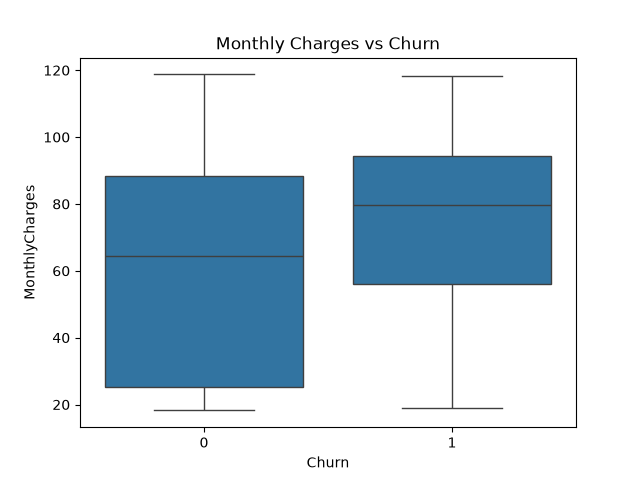
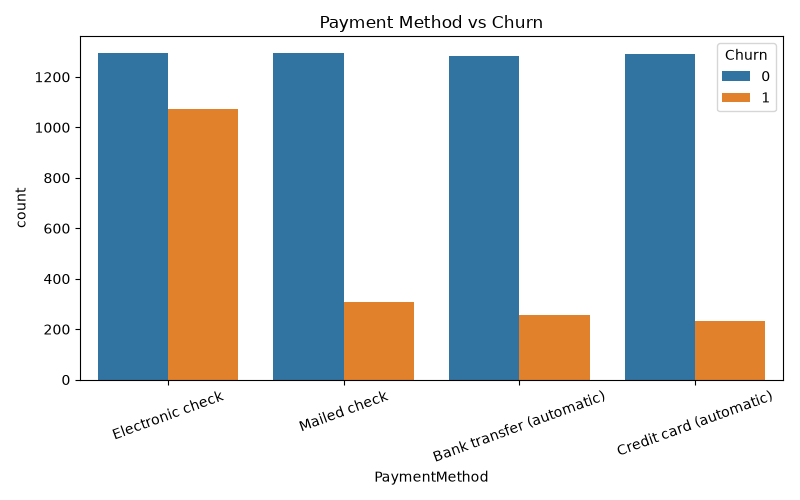
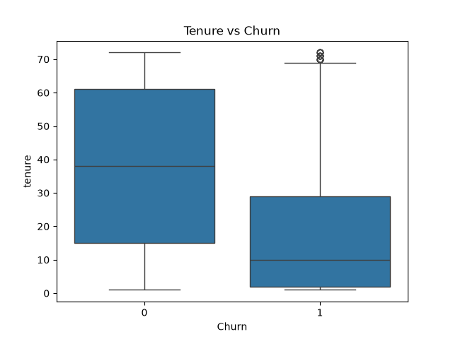

# 📊 Telecom Customer Churn Analysis & Prediction

## 📌 Project Overview

Telecom Customer Churn Analysis is a Data Analytics and Machine Learning project that analyzes customer data to understand why customers leave a telecom company.

The project identifies important factors influencing customer churn and builds machine learning models to predict customers who are likely to leave.

The main objective is to help telecom companies improve customer retention and make data-driven business decisions.

## 🎯 Project Objectives

- Analyze customer data to identify churn patterns.
- Understand the factors affecting customer retention.
- Perform Exploratory Data Analysis (EDA).
- Build and evaluate Machine Learning models.
- Create a Power BI dashboard for business insights.
- Provide recommendations to reduce customer churn.

## 🛠️ Technologies Used

- Python
- Pandas
- NumPy
- Matplotlib
- Seaborn
- Scikit-learn
- Jupyter Notebook
- Power BI
- Git and GitHub

## 📂 Project Structure

```text
telecom-churn-analysis/
│
├── data/
│   └── Raw and cleaned datasets
│
├── images/
│   ├── churn_distribution.png
│   ├── contract_vs_churn.png
│   ├── dashboard.png
│   ├── feature_importance.png
│   ├── model_feature_importance.png
│   ├── monthly_vs_churn.png
│   ├── payment_vs_churn.png
│   └── tenure_vs_churn.png
│
├── models/
│   ├── churn_model.pkl
│   └── churn_model_balanced.pkl
│
├── churn.ipynb
├── churn.html
├── churn_dashboard.pbix
└── README.md
```

## 📊 Exploratory Data Analysis (EDA)

Exploratory Data Analysis was performed to understand customer behavior and identify patterns related to churn.

The following visualizations were created:

### 1. Customer Churn Distribution


### 2. Contract Type vs Churn


### 3. Customer Dashboard


### 4. Feature Importance


### 5. Model Feature Importance


### 6. Monthly Charges vs Churn


### 7. Payment Method vs Churn


### 8. Tenure vs Churn


## 🤖 Machine Learning Model Performance

Three model configurations were evaluated:

| Model | Accuracy | Precision | Recall | F1-Score | ROC-AUC |
|---|---:|---:|---:|---:|---:|
| Logistic Regression | 80.45% | 0.648 | 0.575 | 0.609 | 0.836 |
| Random Forest | 78.68% | 0.621 | 0.508 | 0.559 | 0.818 |
| Logistic Regression (Balanced) | 72.60% | 0.491 | 0.797 | 0.608 | 0.835 |

### Best Model

Logistic Regression achieved the highest overall accuracy and ROC-AUC score.

Balanced Logistic Regression achieved a higher churn recall of 0.797, making it useful when identifying more potentially churned customers is the priority.

### Saved Models

- `models/churn_model.pkl`
- `models/churn_model_balanced.pkl`

## 💡 Business Recommendations

Based on the analysis, the following strategies can help telecom companies reduce customer churn:

1. **Contract Upgrades:** Encourage month-to-month customers to choose long-term contracts through special offers.
2. **Customer Retention:** Introduce loyalty programs and retention campaigns for new customers.
3. **Payment Methods:** Encourage automatic payment methods for convenient billing.
4. **Service Improvement:** Review pricing and service quality for fiber optic customers.
5. **Customer Support:** Provide additional support and service benefits to customers with shorter tenure.

## 🚀 How to Run the Project

### Step 1: Clone the Repository

```bash
git clone https://github.com/jyoshna5906/telecom-churn-analysis.git
```

### Step 2: Navigate to the Project Folder

```bash
cd telecom-churn-analysis
```

### Step 3: Install Required Libraries

```bash
pip install pandas numpy matplotlib seaborn scikit-learn jupyter
```

### Step 4: Launch Jupyter Notebook

```bash
jupyter notebook
```

### Step 5: Run the Project

Open `churn.ipynb` and execute the notebook cells.

To explore the dashboard, open `churn_dashboard.pbix` using Microsoft Power BI Desktop.

## 📁 Project Resources

- [Jupyter Notebook](churn.ipynb)
- [HTML Report](churn.html)
- [Power BI Dashboard](churn_dashboard.pbix)

## 📌 Project Outcome

This project demonstrates how Data Analytics and Machine Learning can be used to understand customer behavior, identify churn risks, and support business decision-making.

It combines data preprocessing, exploratory analysis, predictive modeling, and interactive business reporting in one project.

---

**Technologies:** Python | Pandas | NumPy | Machine Learning | Scikit-learn | Power BI | Git & GitHub

**Project Category:** Data Analytics & Machine Learning
