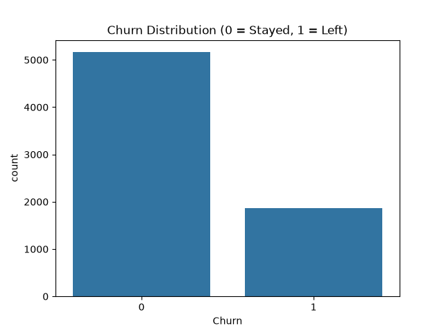
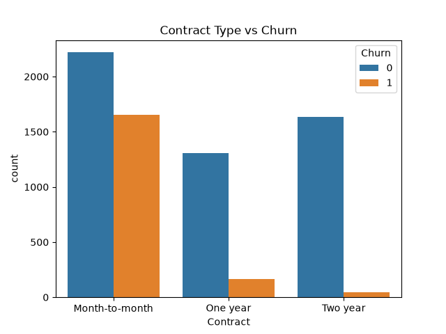
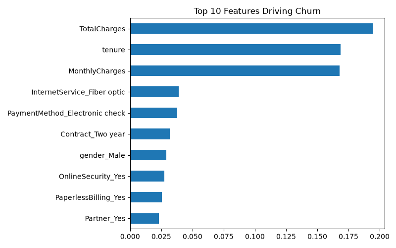
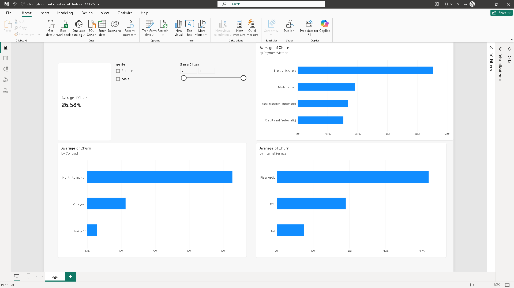
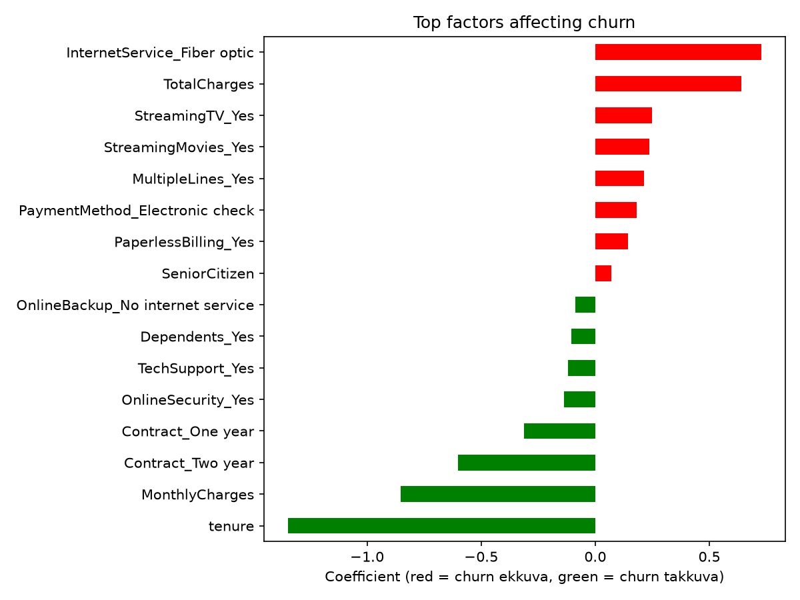

# Telecom Customer Churn Analysis and Prediction

## Problem Statement
Customer churn is a major problem for telecom companies. This project analyzes customer data to find the key reasons for churn and builds machine learning models to predict which customers are likely to leave.

## Dataset
Telco Customer Churn dataset (IBM sample data, via Kaggle) with 7,043 customers and 21 columns. After cleaning, 7,032 records were used.

## Tools Used
Python, Pandas, NumPy, Matplotlib, Seaborn, Scikit-learn, Power BI, Git/GitHub

## Methodology
1. Data cleaning (fixed TotalCharges, removed customerID, encoded Churn)
2. Exploratory Data Analysis (EDA)
3. Model building: Logistic Regression and Random Forest
4. Dashboard creation in Power BI

## Key Findings
- Overall churn rate is 26.58%
- Month-to-month contract churn is 42.7%, versus 2.8% for two-year contracts
- Fiber optic users churn at 41.9%
- Electronic check users churn at 45.3%
- Churned customers have an average tenure of 18 months versus 37.7 months for retained customers
- Churned customers pay higher monthly charges (74.44 vs 61.31)

## Model Results
| Model | Accuracy | Churn Recall | Churn F1 |
|---|---|---|---|
| Logistic Regression | 80.45% | 0.58 | 0.61 |
| Random Forest | 78.68% | 0.51 | 0.56 |

Logistic Regression performed best on this dataset.

## Visuals

## Recommendations
- Offer discounts to move month-to-month customers to longer contracts
- Encourage automatic payment methods
- Run retention campaigns for new customers in their first year
- Review pricing and service quality for fiber optic plans

## How to Run
1. Clone the repository
2. Install libraries: `pip install pandas numpy matplotlib seaborn scikit-learn jupyter`
3. Open `churn.ipynb` and run all cells

## Model Results

| Model | Accuracy | Precision | Recall | F1 | ROC-AUC |
|---|---|---|---|---|---|
| Logistic Regression | 0.804 | 0.648 | 0.575 | 0.609 | 0.836 |
| Random Forest | 0.787 | 0.621 | 0.508 | 0.559 | 0.818 |
| Logistic Regression (balanced) | 0.726 | 0.491 | 0.797 | 0.608 | 0.835 |

**Note:** The balanced model trades precision for recall (0.575 to 0.797), so it catches more customers likely to churn at the cost of more false alarms. Saved as `models/churn_model_balanced.pkl`.

**Best overall model:** Logistic Regression (ROC-AUC 0.836), saved as `models/churn_model.pkl`. Use the balanced model when catching churners matters more than false alarms.

### Top Factors Affecting Churn

**Key insights:**
- Short tenure is the strongest churn indicator; long-term customers rarely leave.
- Customers on 1-year and 2-year contracts churn much less than month-to-month customers.
- Fiber optic internet users show higher churn risk.
- Add-on services like Online Security and Tech Support are linked to lower churn.
- Electronic check payment and paperless billing are linked to higher churn.